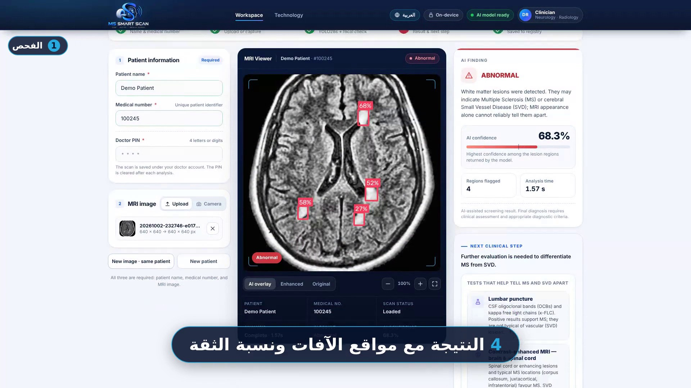
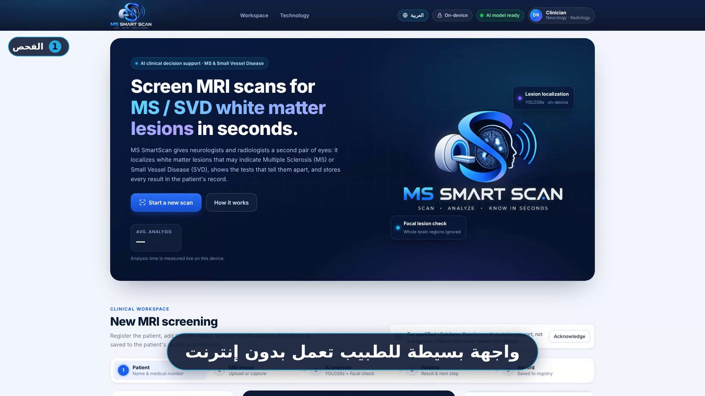
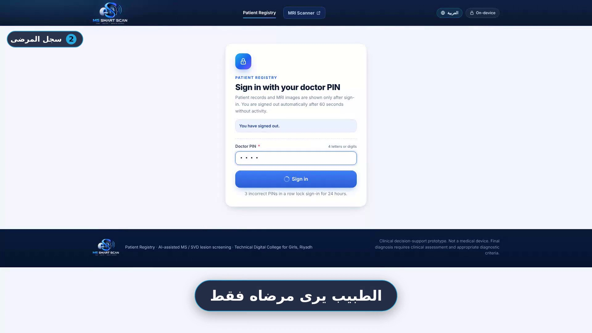
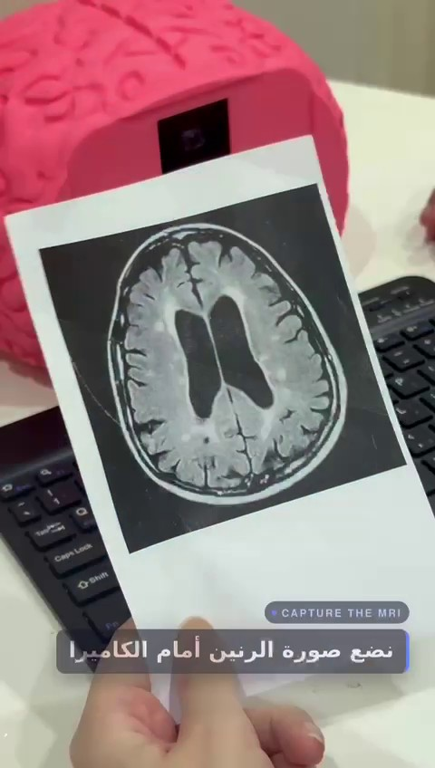
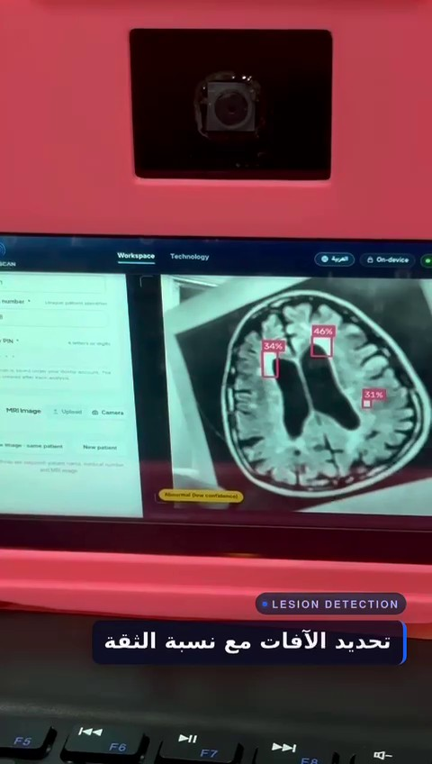
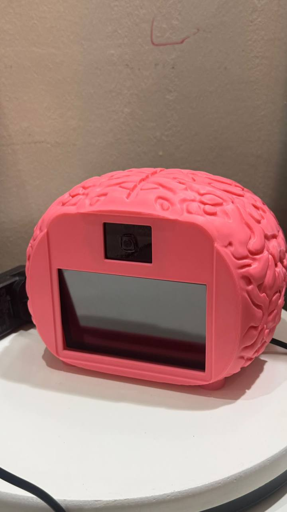
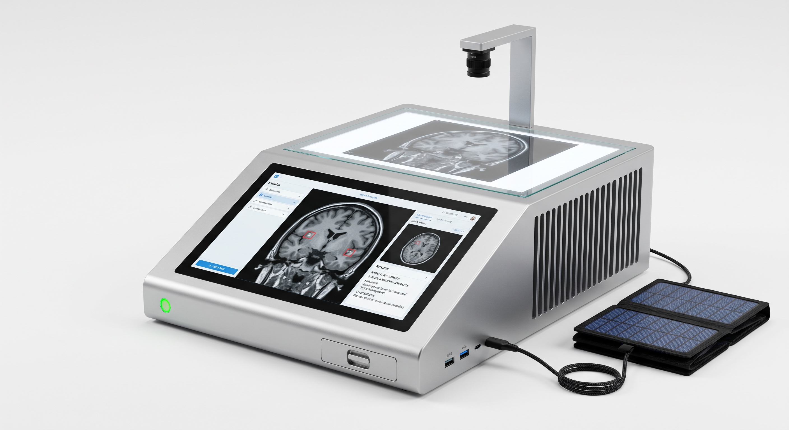

# MS SmartScan

**An offline AI clinical decision-support system that helps radiologists spot white-matter lesions linked to Multiple Sclerosis (MS) on brain MRI in seconds.** It runs on a low-cost Raspberry Pi device and can analyse an uploaded image or a **printed MRI held up to the camera**.

Built for the **Healthon 2026** hackathon.

[English](#english) · [العربية](#arabic) · [▶ Website demo](media/video/website-demo.mp4) · [▶ Hardware demo](media/video/hardware-demo.mp4)

> 🔒 **Source code is confidential.** This repository is a project showcase. The source code, trained models and data are not published.

---

## The Problem

MS lesions are small and easily confused with other findings, and they are usually read by eye alone, which can delay diagnosis and treatment.

- MS prevalence in Saudi Arabia: **40.4 per 100,000** people *(AlJumah et al., 2020)*
- **18%** of patients referred with an MS diagnosis had been misdiagnosed *(Kaisey et al., 2019)*

## The Solution

A second reader for the radiologist: the doctor uploads (or photographs) a brain FLAIR MRI, the AI marks suspected lesions with confidence scores, and the system suggests the diagnostic tests that come next. **The decision always stays with the doctor.**

## How It Works

1. **Patient details + Doctor PIN**: the patient name, medical number and the doctor's 4-character PIN are all required.
2. **Upload or capture**: upload the MRI or photograph it with the device camera.
3. **MRI gate**: a classifier (YOLO26n-cls) accepts only MRI images; anything else is rejected and not saved.
4. **Lesion detection**: a single-class **YOLO26s** detector draws a box and a confidence score around each lesion.
5. **Result + next step**: *Suspected MS / SVD*, *Low confidence* or *Clear*, with the diagnostic tests that help tell MS and small-vessel disease apart.
6. **Patient Registry**: the scan is saved and appears instantly in the registry ("New scan received").

## Key Features

- **Two web apps on one device**: an **MRI Scanner** and a **Patient Registry**, sharing one local database.
- **Fully offline**: patient data never leaves the hospital device.
- **Works on printed scans** via the Raspberry Pi camera.
- **Role-based access**: each doctor sees only their own patients. The department head sees all records and manages doctor accounts (register, suspend, reactivate).
- **Security**: PINs are stored only as salted PBKDF2 hashes. The registry locks for 24 hours after 3 wrong PINs, has rate limiting and a 60-second idle sign-out, and makes daily backups.
- **Live updates**: new scans are pushed to open registry pages instantly (Server-Sent Events).
- **English / Arabic** interface with full right-to-left support.
- **Export to Excel** from the registry.

## Results (team testing)

On patients the model had not seen (MSLesSeg dataset), it flagged lesions in **78%** of affected slices with a **2-4%** false-alarm rate on healthy slices. In a blind test it detected lesions in both MS and SVD cases, which is why the result reads *Suspected MS / SVD*.

> These are team test results, **not clinical validation**. MS SmartScan is a decision-support prototype, not a medical device.

## Tech Stack

Python · Ultralytics **YOLO26s** (lesion detection) + **YOLO26n-cls** (MRI gate) · OpenCV · SQLite · HTML / CSS / JavaScript · Server-Sent Events · Raspberry Pi 5 + Camera Module 3

## My Contribution (Hailah Alhejjei)

- **UX & web development**: designed the doctor's experience and built the two websites, the **MRI Scanner** and the **Patient Registry** (patient records).
- **Database**: the shared SQLite database that links both apps (patients, scans and doctor accounts).
- **Security**: doctor PIN authentication with salted PBKDF2 hashing, plus the access controls around it.

## Screenshots

| | |
|---|---|
|  |  |
| MRI Scanner home page | Patient Registry: doctor PIN sign-in |
|  |  |
| Holding a printed MRI up to the device camera | Lesion detection running on the device |

**Prototype device**

*Initial concept for the advanced version (not built yet): built-in screen, solar power and mirrored storage.*

## Demo Videos

- ▶ [Website demo (54 s)](media/video/website-demo.mp4)
- ▶ [Hardware demo (50 s)](media/video/hardware-demo.mp4)

## Roadmap

Clinical pilot at a university medical city → Saudi MRI data and SFDA registration → rollout to more university hospitals. These goals are estimates and will be reviewed after the first pilot.

## Team

| Name | Role |
|---|---|
| Dana Mohammed Al-Anazi | Team lead: coordination, systems development, presentation |
| Marwah Abdullah Sabai | AI: built, trained and deployed the YOLO26s model on Raspberry Pi |
| **Hailah Abdulrahman Alhejjei** | UX & websites, database and security: doctor experience, MRI Scanner, Patient Registry, PIN hashing |

---

## MS SmartScan

نظام دعم قرار سريري بالذكاء الاصطناعي يعمل **بدون إنترنت**، يساعد طبيب الأشعة على رصد آفات المادة البيضاء المرتبطة **بالتصلب المتعدد** في صور الرنين خلال ثوانٍ. يعمل على جهاز Raspberry Pi منخفض التكلفة، ويحلل الصورة المرفوعة أو **الصورة المطبوعة** أمام الكاميرا. طُوّر في هاكاثون **هيلثون 2026**.

> 🔒 **الكود سرّي:** هذا المستودع للعرض فقط، ولا يتضمن الكود أو النماذج أو البيانات.

### كيف يعمل
بيانات المريض ورمز الطبيب ← رفع الصورة أو تصويرها ← بوابة تتحقق أنها صورة رنين ← كشف الآفات بنموذج YOLO26s مع نسبة الثقة ← النتيجة والفحوصات التالية المقترحة ← حفظ تلقائي في سجل المرضى.

### أبرز المزايا
- موقعان على جهاز واحد: **موقع الفحص** و**سجل المرضى**.
- يعمل بدون إنترنت والبيانات لا تغادر جهاز المستشفى.
- كل طبيب يرى مرضاه فقط، ورئيسة القسم تدير حسابات الأطباء.
- رموز مشفّرة، وقفل بعد المحاولات الخاطئة، وخروج تلقائي، ونسخ احتياطي يومي.
- واجهة بالعربية والإنجليزية، وتصدير إلى Excel.

### مساهمتي (هيله الحجي)
تصميم تجربة الطبيب وبناء الموقعين (**موقع الفحص** و**سجل المرضى**)، وقاعدة البيانات المشتركة، وأمان الدخول بتشفير رموز الأطباء (PBKDF2).

### الفريق
دانا العنزي (قائدة الفريق) · مروة سبعي (الذكاء الاصطناعي) · هيله الحجي (تجربة المستخدم والمواقع وقاعدة البيانات والأمان)

